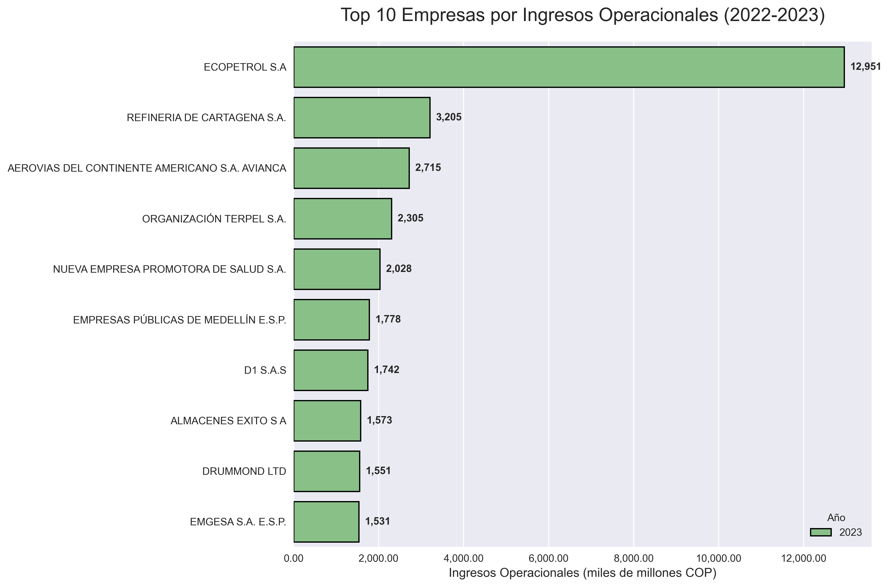
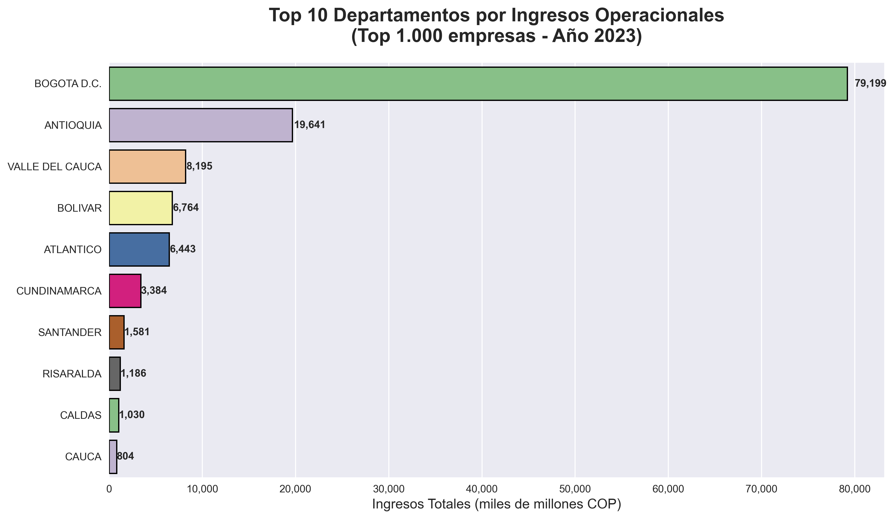
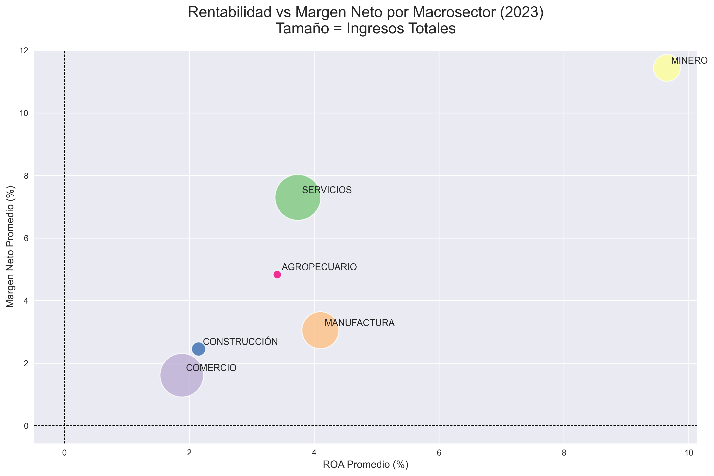
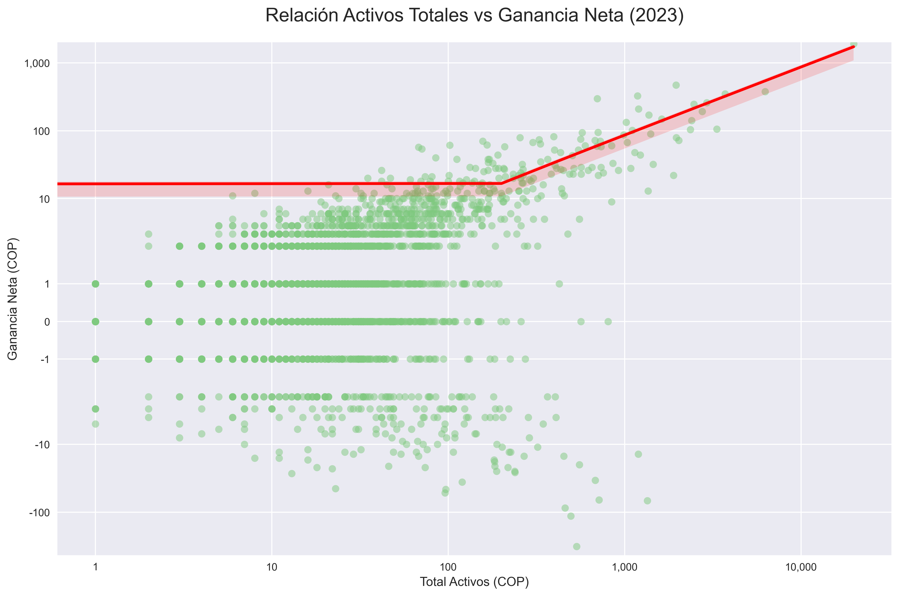
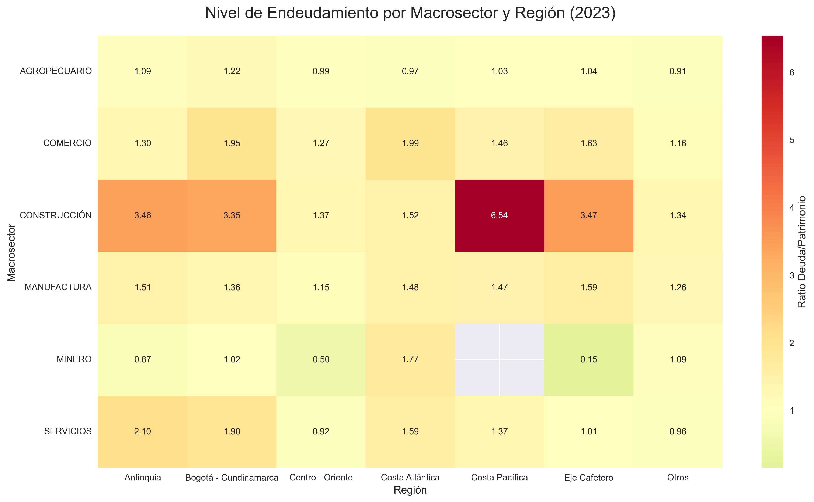

<div align="center">

# Análisis Exploratorio de Datos (EDA) — Empresas Más Grandes de Colombia (2023)

[](notebooks/analisis_top_1000.ipynb)
[](notebooks/analisis_top_1000.ipynb)
[](requirements.txt)
[](LICENSE)

**Estudio financiero y de concentración económica sobre el dataset oficial de las *10.000 Empresas Más Grandes de Colombia* (SuperSociedades / Datos Abiertos), con foco en el corte 2023 y el Top 1.000 por ingresos operacionales.**

**Autor:** Juan Sebastián Sandoval ([@Sebas0317](https://github.com/Sebas0317)) · Bogotá, Colombia · [LinkedIn](https://www.linkedin.com/in/juan-sebastian-sandoval-686264292)

</div>

---

## 📊 Dataset y Alcance

- **Fuente oficial:** [Datos Abiertos Colombia — 10.000 Empresas Más Grandes del País](https://www.datos.gov.co/Comercio-Industria-y-Turismo/10-000-Empresas-mas-Grandes-del-Pa-s/6cat-2gcs/about_data)
- **Volumen:** 40.000 registros consolidados (cortes 2021–2024; 10.000 empresas por año), con análisis focalizado en el **año de corte 2023** y concentración del **Top 1.000**.
- **Unidad monetaria del dataset fuente:** cifras expresadas en **billones de pesos colombianos (COP)**.
- **Variables clave:** `NIT`, `RAZÓN SOCIAL`, `SUPERVISOR`, `REGIÓN`, `DEPARTAMENTO DOMICILIO`, `CIUDAD DOMICILIO`, `CIIU`, `MACROSECTOR`, `INGRESOS OPERACIONALES`, `GANANCIA (PÉRDIDA)`, `TOTAL ACTIVOS`, `TOTAL PASIVOS`, `TOTAL PATRIMONIO`, `Año de Corte`.

---

## ❓ Preguntas de Negocio Respondidas

1. ¿Cuáles son las 10 empresas con mayores ingresos operacionales en Colombia (2023)?
2. ¿Cuál es la distribución geográfica de los ingresos dentro del Top 1.000 empresarial?
3. ¿Qué macrosectores concentran mayor patrimonio y cuál es su rentabilidad promedio (ROA)?
4. ¿Existe relación directa entre el tamaño en activos de una empresa y su ganancia neta?
5. ¿Cómo se comporta el apalancamiento (razón deuda/patrimonio) por macrosector y región?

---

## 📈 Visualizaciones y Hallazgos Clave (Corte 2023)

### 1. Top 10 Empresas por Ingresos Operacionales

- **Ecopetrol S.A. marca una brecha estructural:** registró **$129,51 billones COP** en ingresos operacionales en 2023 (con **$19,06 billones COP** en ganancia neta y **$198,73 billones COP** en activos), superando la suma combinada de las siguientes empresas del ranking.

### 2. Concentración Geográfica del Top 1.000

- **Alta concentración territorial:** **Bogotá D.C.** reúne cerca del **40 %** de los ingresos del Top 1.000; al sumar **Antioquia**, ambas jurisdicciones explican más del **70 %** del ingreso nacional del segmento.

### 3. Desempeño Financiero y ROA por Macrosector

- **Minero-Hidrocarburos lidera en solidez y rentabilidad:** concentra el mayor volumen de ingresos y el ROA promedio más alto.
- **Comercio y Servicios operan con márgenes estrechos:** generan alto volumen de facturación, pero con un ROA promedio inferior al **3 %**.

### 4. Relación entre Tamaño (Activos) y Rentabilidad

- **El tamaño no garantiza eficiencia:** existe correlación positiva entre activos y utilidades, pero con alta dispersión; la eficiencia operativa pesa más que la escala bruta.

### 5. Mapa de Calor de Endeudamiento (Deuda / Patrimonio)

- **Presión financiera en Construcción:** el sector presenta los mayores niveles de apalancamiento, con razones Deuda/Patrimonio superiores a **6,5** en la Costa Atlántica y por encima de **3,0** en varias regiones.

---

## 📂 Estructura del Repositorio

```text
analisis-top-1000-empresas-colombia-2023/
├── data/
│   ├── raw/                 # Dataset original de Datos Abiertos Colombia
│   └── proccessed/          # Datos limpios y transformados
├── graphics/                # Gráficos generados en alta resolución (PNG)
├── notebooks/
│   └── analisis_top_1000.ipynb
├── requirements.txt
├── LICENSE
└── README.md
```

---

## 🚀 Cómo Reproducir el Análisis

```bash
git clone https://github.com/Sebas0317/analisis-top-1000-empresas-colombia-2023.git
cd analisis-top-1000-empresas-colombia-2023

python -m venv .venv
source .venv/bin/activate  # Windows: .venv\Scripts\activate
pip install -r requirements.txt

jupyter notebook notebooks/analisis_top_1000.ipynb
```

---

## 📄 Licencia

Distribuido bajo la [Licencia MIT](LICENSE).
